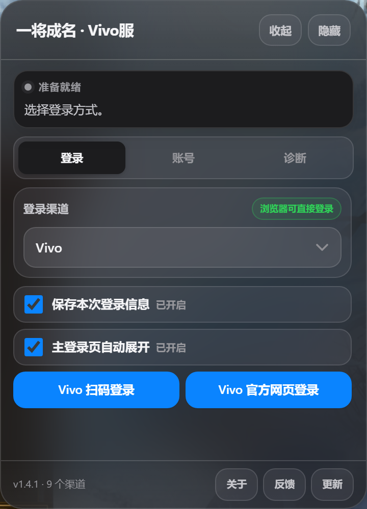
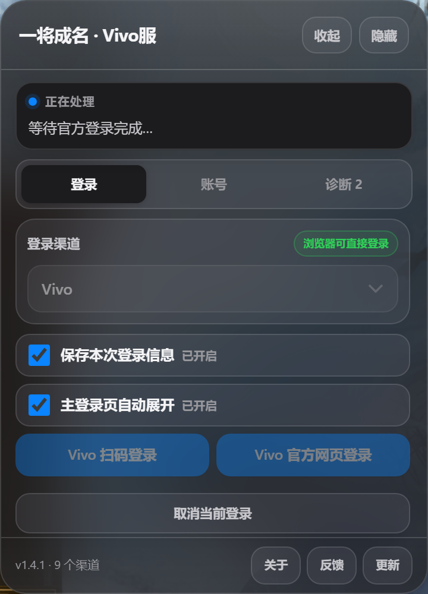
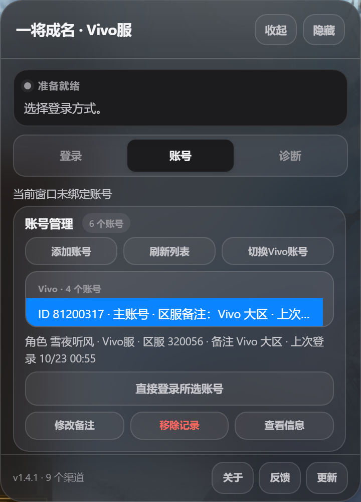
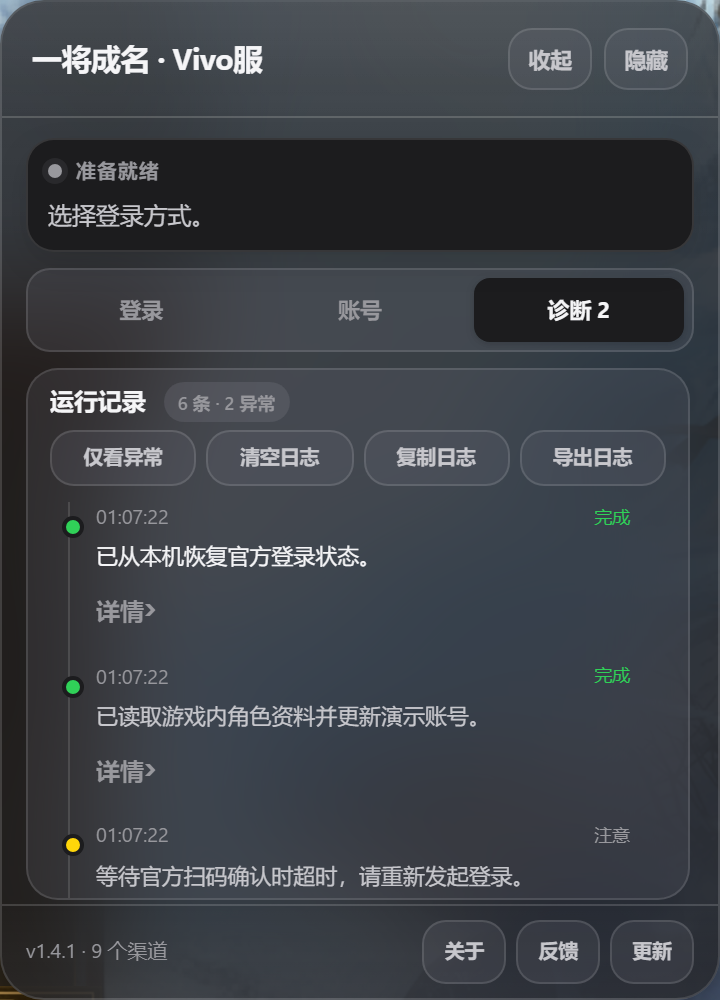
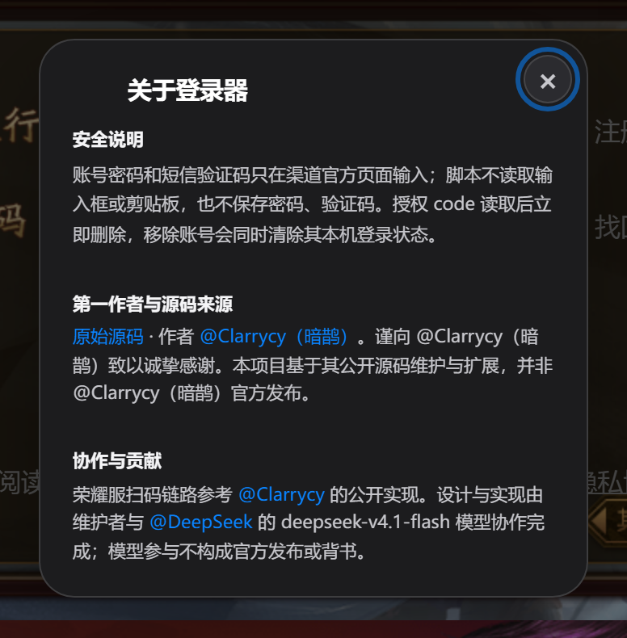

# 三国杀一将成名 · 多渠道网页登录器

在三国杀网页版登录页提供一个统一的多渠道登录面板，把当前浏览器会话接到渠道官方的扫码、网页授权和游卡兑换链路，并在本机提供账号管理与快速直登。

当前版本：`1.4.1`
支持渠道：小米、Vivo、OPPO、华为、荣耀、哔哩哔哩、WeGame、应用宝、Steam（共 9 个）<br>
运行方式：Tampermonkey 用户脚本（Chrome / Edge / QQ 浏览器极速模式）

> 本项目是本地辅助工具，不绕过官方登录、实名、支付或风控。最终能否登录仍由渠道服务器、游卡服务器及账号状态共同决定。  
> 截图中的账号名称、区服和记录均为演示数据。

## 第一作者与源码来源

- 第一作者：**[@Clarrycy](https://github.com/Clarrycy)（暗鹊）**。
- 原始源码：[@Clarrycy（暗鹊）《统一登录器》](https://github.com/Clarrycy/jinnangmiaoji/blob/main/jinnangdai/payload/unified-login.user.js)。
- 本项目基于上述源码整理、维护与扩展。谨向 [@Clarrycy](https://github.com/Clarrycy)（暗鹊）致以诚挚感谢；本仓库并非 @Clarrycy（暗鹊）官方发布。
- 协作与致谢：[@Clarrycy](https://github.com/Clarrycy)（荣耀服扫码链路参考其公开《统一登录器》实现）、[@DeepSeek](https://github.com/DeepSeek)。
- AI 协作：本项目在设计、实现、测试与文档整理过程中由 `deepseek-v4.1-flash` 模型协作完成；模型参与不构成 DeepSeek 官方发布或背书。
- 完整贡献者与协作说明：[CONTRIBUTORS.md](CONTRIBUTORS.md)；GitHub 自动统计页：[Contributors](https://github.com/softbad123/sanguosha-channel-login/graphs/contributors)。
- 维护者：softbad123。修改说明、第三方来源与许可证状态见 [THIRD_PARTY_NOTICES.md](THIRD_PARTY_NOTICES.md)。

## 1.4.1 更新

`1.4.1` 将登录、账号、诊断三页统一放入固定 `360 × 500px` 面板，去掉折叠箭头和不必要的说明文字，把安全说明、作者与源码来源收进“关于”弹窗。账号列表与运行日志改为内部滚动，二维码改为屏幕中央弹窗，取消当前登录按钮始终完整可见。

详细发布说明与测试记录见 [`docs/RELEASE-v1.4.1.md`](docs/RELEASE-v1.4.1.md)。

### 固定面板与功能键

- 面板在登录、账号、诊断三页之间保持固定尺寸；标题、状态卡、页签和页脚常驻，仅当前页内容滚动。
- 登录页压缩登录按钮与保存开关，删除“授权后卡在 404／空白页？”手动回填入口，并为“取消当前登录”固定预留 `34px` 高度。
- 账号页始终展开账号管理与账号列表，不再使用右侧折叠箭头；账号增多时仅在列表内部滚动。
- 诊断页始终展开运行记录，使用单行四列工具条；日志增长时仅在日志区域内部滚动。
- 安全说明、第一作者、源码来源、贡献者与 AI 协作信息移入页脚“关于”弹窗。

### 扫码与验证

- 二维码改为屏幕中央的 `240px` 弹窗；点击右上角关闭、点击遮罩或按 `Esc` 都会取消本次扫码流程。
- 已在标准窗口与 `1280 × 480` 矮窗口中验证面板无截断、三页尺寸稳定，账号与日志内部滚动正常。
- `npm test` 的 34 项回归测试全部通过，正式版与本地测试版均通过语法检查及 Chrome DevTools Protocol 布局测试。

## 1.4.0 更新

`1.4.0` 修复了渠道账号选中状态在刷新、回退或官服登录后污染账号记录的问题，恢复荣耀服扫码，并新增应用宝 QQ / 微信扫码。身份归属被拆成可验证、可回归测试的独立边界。

详细发布说明见 [`docs/RELEASE-v1.4.0.md`](docs/RELEASE-v1.4.0.md)。

### 新增与恢复渠道

- 恢复荣耀服面板扫码：荣耀账号二维码 → 荣耀账号服务票据 → 荣耀游戏中心 → AnySDK → 游卡；已通过实际扫码登录验证。
- 新增应用宝 QQ / 微信扫码：使用应用宝平台号 `335`、腾讯 YSDK 渠道 `320460`、游卡网页渠道 `1036` 和独立 `yybqq` / `yybwx` 会话，绝不复用 WeGame 的 QQ / 微信记录。
- 微信登录使用腾讯 YSDK 的二维码签发、长轮询和一次性 code 校验；微信 code 在发起校验前清除，失败后不能重放。
- 应用宝微信二维码请求使用专用微信主机策略，不再被通用 API 白名单误拦截；真实接口已验证二维码签发和轮询格式。
- QQ 登录要求官方授权返回 `pay_token`，并通过 YSDK 校验；若浏览器授权未返回该字段，会以 `YYB_QQ_PAY_TOKEN_MISSING` 安全失败，不会生成账号记录。
- YSDK 的 QQ 校验响应可能返回另一个 ID 空间的 `openid`。脚本按官方客户端语义保留 QQ 授权回调的 `openid`、`access_token` 和 `pay_token` 作为账号身份，不再因响应 `openid` 不同而中断；校验失败仍不会写入账号记录。
- 应用宝 AnySDK 会话必须属于 `newysdk` 平台 `335`。游卡 grant 兼容官方网页渠道 `1036`、YSDK 别名 `320460`，或在字段缺失时由已校验的 AnySDK 会话绑定身份；其他渠道号仍会被拒绝。进入网页版游戏时统一规范化为官方网页渠道 `1036`。

### 身份隔离与账号记录

- 修复先登录 Vivo 渠道服、刷新或回退后再登录官服时，官服角色 ID 被写入原 Vivo 账号记录的问题。
- `sessionStorage` 中的渠道账号上下文只用于恢复面板预选，不再被当成当前游戏会话已属于该账号的证明；只有本次标签页内完成授权、启动交接或与已有角色资料精确匹配后，才允许写入账号记录。
- 当游戏返回的角色 ID、登录账号或渠道账号与已选账号记录冲突时，脚本会阻止更新、解除残留绑定并写入诊断日志，不会再污染原账号或错误显示渠道标题。
- 浏览器标签标题只使用已验证的账号绑定，并显示该记录实际所属渠道；刷新后仅恢复的预选账号不会再让官服页面显示为 `Vivo服`。
- 游戏页探针与游戏桥接数据统一经过同一身份校验入口，避免后续新增资料字段时绕过冲突保护。
- 新增身份隔离回归测试，覆盖官服污染、同渠道刷新恢复、bfcache 残留绑定、全新账号首次写入和部分身份数据等场景。

## 1.3.0 更新

`1.3.0` 相对 `1.2.0` 集中修复游戏内 ID 读取不完整、账号管理直登反复要求重新授权、登录面板折叠时机不可控等问题，同时收紧日志保留策略和更新检查行为。

### 账号与游戏内 ID

- 账号列表统一为 `游戏内 ID · 账号 · 区服备注 · 上次登录时间`；游戏内 ID 优先读取 `UserData.Self.UserBrief.userID`，未识别到 ID 或未填写备注时自动省略对应段，不再显示空占位。
- 游戏内 ID 改由注入游戏自身 `Sgs` 闭包的主世界探针读取，覆盖 `scriptContent`、脚本 `text` 和登录协议回调等入口；即使加载钩子接入偏晚，也能在角色资料就绪后回填。
- 探针会缓存最后一次完整角色身份，并把后续仅返回区服等部分字段的读取与缓存合并，避免 `userID`、角色名被不完整数据覆盖。
- 小米渠道同步改用同一套角色资料探针，不再把 `AccountInfo.Self.UserId` 误当成游戏内 ID。
- 区服默认不展示，仅在账号备注 `zoneNote` 存在时显示 `区服备注：…`；WeGame 的 QQ / 微信等通道可用备注区分，不再出现“区服未同步 / 区服未记录”占位。
- 账号选择改为可访问的自定义列表，选中高亮铺满整行，支持鼠标、方向键、Home 和 End。

### 登录与面板

- 官服原生账号选择器只代表官服登录态，不再参与渠道服折叠判断；主登录页不会因为 `#selectGame` 显示、刷新或切换账号而误收起插件。
- 主登录页默认展开，并新增持久化选项“主登录页自动展开”。关闭该选项后，主登录页沿用上次折叠状态；重新开启会立即展开。
- 插件渠道登录成功、点击官服“进入游戏”或进入游戏页后自动折叠；手动展开不再写入“已自动折叠”标记，因此不会屏蔽下一次真实登录成功的折叠。
- 账号管理直登修复：账号已绑定但当前标签仍处于 `waiting / loading / failed / disconnected` 时，会重新恢复本地登录，而不是误判为“这里就是该账号的游戏窗口”。
- 已保存会话可在 `/x|10|10th|login/pc/` 等任意游戏路由直接走一次性交接，不再因为账号管理从其他渠道的游戏页启动而经过不存在的中间登录页、被迫重新扫码。
- 开启“保存本次登录信息”时，每次成功恢复都会刷新本地会话记录的更新时间，避免旧记录持续抢占 `savedSession()` 而让快捷登录表现得时好时坏；恢复失败仍保留账号记录，便于重新授权。
- 页面卸载时集中清理账号刷新、资料同步、登录轮询、窗口 presence 和临时授权键；单个清理步骤失败不会阻断后续清理。

### 日志、诊断与更新

- 反馈日志升级为可溯源诊断：记录 `traceId`、流程、阶段、错误码、HTTP 状态、通道、异常类型、源码文件、行列号、堆栈及最多四层 `cause` 链；登录恢复、重试、回调、启动交接和自动折叠异常都会主动入库。
- 日志保留策略收紧为最近 3 个会话、最长 3 天、最多 80 条（约 48 KiB）；导出时附带按脚本版本、渠道和会话聚合的摘要，长期使用不会无限堆积。
- 日志存储损坏或写入失败时回退到页内内存缓冲，当前页面仍可复制或导出；URL 查询串、授权码、token、ticket、Cookie、Bearer 和长随机标识继续脱敏。
- 手动“检查更新”发现新版本后直接打开固定的 Release 资产地址，由 Tampermonkey 接管安装页；没有新版本时只提示“已是最新版本”。自动检查仍只在面板标记更新，不会自行打开标签页。
- 增加已知游戏/音频运行时噪声过滤，避免 `AgoraRTC` 等与登录无关的报错挤占日志；错误对象只解析一次，直登引擎与宿主共用同一个 `traceId`。

### 回归验证

- Node 回归测试扩充到 30 项，新增游戏内 ID 探针、账号管理直登、窗口打开状态、页面卸载清理、自动展开持久化和日志会话保留等覆盖。
- 界面截图使用独立浏览器和虚构演示账号生成，不包含真实渠道凭据、账号或角色信息。

## 1.2.0 更新

`1.2.0` 相对 `1.1.4` 建立了自动更新、本地反馈日志和菜单式面板三项基础能力。

### 自动更新

- 增加 GitHub Release 更新检查：每 24 小时最多自动检查一次，也可以从面板页脚或油猴菜单手动检查。
- 更新下载固定使用 `releases/latest/download/sanguosha-channel-login.user.js`，安装和覆盖仍由 Tampermonkey 完成。

### 本地反馈日志

- 自动记录脚本启动、阶段状态和脚本自身异常；同一消息会合并计数，避免重复刷屏。
- 初始保留策略为 240 条、30 天、约 96 KiB，按滚动窗口保存；`1.3.0` 进一步收紧为 3 个会话、3 天、80 条、约 48 KiB。
- 写入前隐藏 URL 查询参数、授权码、token、ticket、Cookie、会话字段和长随机标识；日志不上传，需用户主动复制或导出。
- 运行记录提供“复制日志”“导出日志”和“问题反馈”；油猴菜单可检查更新、复制日志、打开反馈页和清空本机日志。

### 菜单式面板

- 面板改为“登录 / 账号 / 诊断”三页菜单，外框固定为 360×500px（矮窗口自动收缩），三页切换不再跳动；状态卡、页签和页脚常驻，功能按钮按固定窗口紧凑排列。
- 登录页为“取消当前登录”预留空间；账号页使用自适应账号列表，诊断页使用单行工具条和自适应日志区。账号与日志分别在内部滚动，增长时不会撑大面板。
- 账号管理和运行记录始终展开，不提供折叠箭头，避免收纳后产生无意义的空白。
- 折叠态缩至 208px，只保留标题和“展开”按钮，减少对游戏页面的遮挡；拖动位置仍受视口边界约束。
- 登录成功后的自动折叠改为幂等操作，同一页面只执行一次，避免重复通知和重复收起。

## 1.1.4 更新

- 增加 QQ 浏览器专项兼容：同站导航被浏览器提升到新标签、或浏览器清空 `window.name` 时，从标签级一次性交接记录恢复不透明路由名，不再直接丢失登录凭证。
- QQ 浏览器的无凭证入场守卫延长至 240 秒，与游戏交接上限一致，覆盖 Laya 资源加载和慢网络下延迟出现的 `EnterLoginScene` / `GotoLogout`；其他浏览器仍保持 60 秒。
- 修复登录回退目标错误：`/login/x/index` 或无有效交接的游戏页不再被送往经典 OL 的 `/login/index.html`，统一回到一将成名 `/login/10th_client/index.html`。
- 新增 QQ 浏览器交接回归测试，覆盖 `window.name` 丢失、标签标记匹配、跨标签拒绝和过期交接。

## 1.1.3 更新

- 修复 WeGame 在登录检测成功后进入加载页、加载完成又返回主登录页的问题：不再把 `PlatformID` 误当作游戏登录凭证，只有 `Token`、`Ticket` 或 `WeGameTicket` 已写入时才允许官方登录场景继续。
- 登录交接成功后保留 60 秒入场守卫，覆盖场景加载、游戏对象重绑定和慢网络下的延迟 `EnterLoginScene` / `GotoLogout` 调用；正常登录仍会立即继续。
- 面向慢网络的中间等待改为有界宽限：官方接口单次请求最多 60 秒，游戏交接与资料同步最多 240 秒。超时只用于防止永久卡住，不会人为拖慢正常流程。
- “游戏票据已提交”不再直接显示为“已登录”；只有读取到角色、区服或角色 ID 等真实游戏资料后，才把账号状态切换为 `connected`。

## 1.1.2 更新

- 修复 WeGame 账号被错误拼接为“区服待返回 · 未打开 · 待登录”的状态显示，改为明确的登录、区服和窗口状态。
- 进入游戏后从 `AccountInfo` 与 `UserData` 补充角色名、角色 ID、登录账号和区服。
- 账号资料同步只在游戏页、资料不完整时短时运行，不再全页面永久轮询。
- 在脚本元数据、登录面板、README 与许可证声明中补充第一作者 @Clarrycy（暗鹊）及固定源码链接。

## 界面预览

<table>
  <tr>
    <td align="center"><a href="docs/screenshots/v1.4.1/login.png"></a><br><sub>登录页：固定 360 × 500px</sub></td>
    <td align="center"><a href="docs/screenshots/v1.4.1/login-cancel.png"></a><br><sub>登录进行中：“取消当前登录”完整可见</sub></td>
  </tr>
  <tr>
    <td align="center"><a href="docs/screenshots/v1.4.1/accounts.png"></a><br><sub>账号页：列表内部滚动，无折叠箭头</sub></td>
    <td align="center"><a href="docs/screenshots/v1.4.1/diagnostics.png"></a><br><sub>诊断页：单行工具条与内部滚动日志</sub></td>
  </tr>
  <tr>
    <td align="center"><a href="docs/screenshots/v1.4.1/qr.png"></a><br><sub>扫码：屏幕中央 240px 弹窗</sub></td>
    <td align="center"><a href="docs/screenshots/v1.4.1/about.png"></a><br><sub>安全、作者、源码与协作信息收进“关于”</sub></td>
  </tr>
</table>

## 功能特性

- 统一面板：在三国杀网页版登录页切换渠道，不需要分别安装多个渠道脚本。
- 官方登录链路：扫码二维码在屏幕中央弹窗显示；账号密码、短信验证码、Steam Guard 等敏感操作在渠道官方页面完成。
- 账号管理：保存账号展示信息后，可在账号管理中选择账号并直接登录；跨渠道账号会自动切换渠道后继续。
- 菜单式面板：登录、账号和诊断共用固定外框；登录操作键按窗口高度紧凑排布，账号列表与运行日志在各自区域内滚动，记录增长不会改变窗口尺寸。
- 保存本次登录信息：默认开启。开启后只在本机保存可恢复的官方登录状态；关闭后不留下本次登录记录。
- 自动收尾：检测到官方账号登录完成后关闭本次登录弹窗；插件渠道登录成功、点击官服“进入游戏”或进入游戏页后自动收起为紧凑标题栏。主登录页可通过持久化选项设置是否默认展开。
- 独立流程：WeGame 的 QQ 与微信使用独立流程令牌、会话键和恢复记录，避免相互取消。
- 自动更新：每天最多检查一次 GitHub Release；可在面板或油猴菜单手动检查。更新仍由 Tampermonkey 的脚本安装/更新链路完成。
- 本地优先：账号、会话和反馈日志只写入 Tampermonkey 本地存储，不上传到额外服务器。
- 诊断信息：只保留运行记录与排障工具；安全说明、第一作者与源码来源收纳在页脚“关于”中。

## 支持渠道

| 渠道 | 平台号 | 游戏渠道号 | 登录方式 | 说明 |
| --- | ---: | ---: | --- | --- |
| 小米 | 10038 | 320052 | 面板扫码；官方网页登录 | 官方 OAuth 与网页版游戏交接 |
| Vivo | 10031 | 320056 | 面板扫码；官方网页登录 | 官方 passport 与 joint 桥接 |
| OPPO | 10030 | 320123 | HeyTap 官方扫码 / 手机号等网页方式 | 官方 code 一次性回传 |
| 华为 | 332 | 320459 | 面板扫码 | 二维码、账号授权与游卡兑换 |
| 荣耀 | 50027 | 320463 | 面板扫码 | 荣耀账号二维码、游戏中心实名校验与游卡兑换 |
| 哔哩哔哩 | 50003 | 120133 | 面板扫码 | access_key 与游戏回调交接 |
| WeGame | 326 | 320023 | QQ 扫码；微信扫码 | QQ / 微信使用独立流程和会话记录 |
| 应用宝 | 335 | 1036 | QQ 扫码；微信扫码 | YSDK 校验使用 `320460`；游卡网页路由使用 `1036`；QQ 缺少 `pay_token` 时安全失败 |
| Steam | 50000 | 320061 | Steam 官方 OAuth 网页 | 扫码、账号密码和 Steam Guard 以官方页面为准 |

4399、飞火、顺网、2144、紫霞、QQ 大厅、7K7K、百度、360 等门户渠道不在本脚本的下拉框中显示；请直接在对应官网登录和进入游戏。

## 安装方法

### 方式一：从 Release 安装（推荐）

1. 在 Chrome、Edge 或 QQ 浏览器极速模式中安装 [Tampermonkey](https://www.tampermonkey.net/)。建议使用 `5.5.1` 或更新版本；旧版 `4.18.1` 在 QQ 浏览器使用的 Chromium 138 中可能无法注入脚本。
2. 打开本项目的 [最新 Release](https://github.com/softbad123/sanguosha-channel-login/releases/latest)。
3. 下载固定更新地址中的 [`sanguosha-channel-login.user.js`](https://github.com/softbad123/sanguosha-channel-login/releases/latest/download/sanguosha-channel-login.user.js)，在 Tampermonkey 中导入并启用。Release 中可能同时提供带版本号的副本，内容相同。
4. 停用或删除旧的“小米服登录器”“统一登录器”以及旧版“三国杀多渠道登录”脚本，避免同页重复注入。
5. 打开 <https://web.sanguosha.com/login/10th_client/index.html>。
6. 页面右侧出现登录面板后，确认页脚显示 `v1.4.1 · 9 个渠道`。

### 方式二：从源码安装

1. 下载仓库中的 `三国杀多渠道登录.user.js`。
2. 打开 Tampermonkey 管理面板，进入“实用工具 → 从文件导入”，选择该文件。
3. 保存并确认脚本处于启用状态，然后刷新三国杀登录页。

也可以新建一个用户脚本，将 `三国杀多渠道登录.user.js` 的完整内容粘贴进去后保存。不要同时启用多个会注入登录面板的版本。

## 使用说明

### 选择渠道并登录

1. 在面板的“登录渠道”下拉框中选择渠道。
2. 点击对应的扫码或官方网页登录按钮。
3. 扫码二维码会出现在屏幕中央的弹窗中，用手机完成扫码和确认；官方网页登录时，在弹出的官方页面完成账号密码、短信或第三方登录。
4. 通过插件发起的账号识别成功后会关闭本次登录弹窗；读取到有效角色、区服或账号资料后自动把面板收起为紧凑标题栏。
5. 需要继续操作时，点击标题栏的“展开”。登录页的“主登录页自动展开”选项默认开启；官服账号选择器的显示、刷新或切换不会收起插件。插件渠道登录成功、点击官服“进入游戏”或进入游戏页后会折叠。关闭该选项后，主登录页会沿用上次折叠状态。“隐藏”会隐藏整个面板，可从油猴菜单重新显示。

### 账号管理

- 选择已有账号后点击“直接登录所选账号”，脚本会优先复用本机保存且仍有效的登录状态。
- 保存的 SGS 票据失效时，脚本会用本机保存的上游渠道凭据重新兑换一次游戏票据；失败不会删除账号记录。
- 选择其他渠道的账号时，按钮会显示“切换到对应渠道并直接登录”，切换后自动继续，不需要再次点选登录方式。
- 已打开的账号窗口会被优先聚焦；只有当前标签页正在游戏且需要添加另一个账号时，才会打开独立账号窗口。
- 账号管理只展示昵称、角色名、区服、账号标识、最近登录方式和备注等必要信息。

### 保存本次登录信息

- 开关默认开启。开启时，成功登录后会保存账号展示信息和可用于下次恢复登录的渠道会话记录；其中可能包含渠道 token 或票据。
- 关闭时，本次登录仍可完成游戏交接，但不会新增或更新持久账号记录，也不会写入可恢复会话；因此下次无法从账号管理直接恢复这次登录。
- 移除账号记录时，会同时清理该账号名下保存的恢复会话。
- 保存内容位于 Tampermonkey 的本地存储中。分享脚本源码不会带走这些记录；分享浏览器配置、Tampermonkey 数据目录或整机备份则可能带走。

### WeGame 的 QQ 与微信

QQ 和微信是两条独立登录流程，分别使用独立的流程令牌、会话键和恢复记录。先登录 QQ 再登录微信，或反向切换，不会让旧流程的取消事件终止新流程。

### Steam

Steam 登录使用 `store.steampowered.com` 官方 OAuth 页面。扫码、账号密码和 Steam Guard 都由 Steam 官方页面处理；插件只接收一次性的官方回调结果。若页面无法加载，请先确认浏览器可正常打开 Steam 商店并检查网络或代理。

## 安全与隐私

- 不读取账号密码、短信验证码、验证码输入框或剪贴板。
- 不保存账号密码或验证码。
- 渠道授权信息只在本机临时状态或用户开启的恢复记录中保存，不上传到额外服务器。
- 游戏启动票据只在当前标签页短暂保留并一次性消费。
- 反馈日志只保存在本机，不会静默上传；复制或导出前会隐藏 URL 查询参数及常见的 token、ticket、授权码、Cookie 和会话字段。
- 脚本的 `@connect` 只列出登录流程所需的官方域名；如需审计，请从 `三国杀多渠道登录.user.js` 头部开始检查。
- 不要把 `_chrome-profile*`、`_edge-profile*`、`_tm-extension`、浏览器配置目录、日志、抓包 HTML、二维码截图或 Tampermonkey 数据目录上传到公开仓库。

## 常见问题

**面板没有出现**  
确认 Tampermonkey 已启用、脚本匹配 `https://web.sanguosha.com/*`，并停用其他旧登录脚本后刷新页面。QQ 浏览器请使用极速模式，并升级到 Tampermonkey `5.5.1+`；`4.18.1` 可能显示扩展已启用但无法向 Chromium 138 页面注入脚本。

**QQ 浏览器菜单显示“没有运行中的脚本”**

“已启用”只表示 Tampermonkey 扩展本身已启用；“没有运行中的脚本”表示当前标签页没有匹配到正在运行的用户脚本。请确认页面处于 QQ 浏览器“极速模式”而非兼容/IE 模式，Tampermonkey 的站点访问权限允许 `web.sanguosha.com`，脚本已在管理面板启用；导入后对目标页执行硬刷新（`Ctrl+Shift+R`）或重新打开标签页。若登录面板已经出现，说明注入正常，后续跳回登录页应按下一节的交接问题排查。

**扫码成功但游戏没有继续**  
先查看面板状态和“运行记录”中的阶段与 HTTP 状态；不要连续点击多个渠道按钮，等待当前流程结束或先取消。

**账号管理直登失败**  
本机恢复会话可能已失效。账号记录会保留，重新完成一次该渠道的官方授权后即可再次直登。

**Steam 页面打不开**  
确认 `store.steampowered.com` 可访问，并检查代理、DNS 和浏览器拦截规则。

**华为 / 荣耀 / 哔哩哔哩没有账号密码入口**<br>
这三个渠道当前只保留经过验证的扫码或官方登录链路，不展示无法完成游戏交接的灰色按钮。

**应用宝扫码后提示 `YYB_QQ_PAY_TOKEN_MISSING`**<br>
QQ 浏览器授权没有返回应用宝校验所需的 `pay_token`。脚本会主动停止，不会把不完整票据写入账号管理；请改用应用宝微信扫码，或等待官方 QQ 授权链路返回完整字段。

**应用宝微信没有出现二维码**<br>
请确认使用的是最新正式版，并已停用旧版脚本。`1.4.1` 的应用宝微信链路使用专用受信主机策略；若仍失败，请从“运行记录”导出反馈日志，重点查看 `stage` 是否为 `yyb_wx_qr` 或 `yyb_wx_poll`。

**应用宝扫码后提示 `YYB_CHANNEL_MISMATCH`**<br>
应用宝的腾讯 YSDK 渠道 `320460` 与游卡网页渠道 `1036` 属于两个不同的命名空间。`1.4.1` 会分别校验 AnySDK 的 `newysdk` / `335` 身份与游卡 grant，并将进入网页版的渠道统一为 `1036`。请确认已停用旧脚本并使用最新正式版；若仍出现，请导出诊断日志并重点查看 `stage` 是 `sgs_session` 还是 `sgs_grant`。

**账号列表为什么没有显示区服**

`1.3.0` 起区服默认不展示，只在账号备注中填写后才显示 `区服备注：…`。这是刻意设计：服务器编号很少需要日常查看，而 WeGame 的 QQ / 微信等通道更适合用备注区分。游戏内 ID 会从 `UserData.Self.UserBrief.userID` 自动读取；若暂未进入角色大厅，ID 段会暂时省略，不会显示占位或空分隔符。

**登录后进入加载页，又返回主登录页**

`1.1.3` 已修复 WeGame 的 `PlatformID` 凭证误判；`1.1.4` 又修复了 QQ 浏览器丢失 `window.name` 后交接无法恢复，以及回退到经典 OL 登录页的问题。若仍复现，请先确认版本为 `1.4.1`、Tampermonkey 为 `5.5.1+`、没有同时启用旧版登录脚本，再从“运行记录”复制或导出反馈日志；日志中会显示失败所在的流程、阶段、错误码、源码行列号和 `cause` 链，便于直接定位。QQ 浏览器慢网下请给官方请求和游戏加载最多 4 分钟，不要连续重复点击登录。

**慢网络下如何理解超时**

脚本没有加入固定延时。官方接口请求最多等待 60 秒，票据交给游戏后的入场与资料同步最多等待 240 秒；QQ 浏览器的无凭证入场守卫也使用完整的 240 秒上限。网络恢复后流程会继续。若超过上限仍失败，通常是渠道票据失效、游戏服务器不可达或页面已关闭，请重新发起官方授权而不是反复点击旧流程。

## 开发与验证

- `_direct_engine.js` 是独立登录引擎；主脚本中的内嵌引擎必须与其逐字一致。
- 修改引擎后运行 `npm run sync:engine`，由 `tools/sync-embedded-engine.js` 更新内嵌副本，避免手工复制造成版本漂移。
- `tests/_test_embedded_engine_sync.js` 同时校验内嵌一致性以及元数据、宿主、引擎三处版本号。
- `tests/_test_login_options.js` 校验 9 个可见桥接渠道、荣耀扫码入口以及应用宝 QQ / 微信独立入口。
- `tests/_test_honor_engine.js` 校验荣耀二维码 Cookie 复用、XML 解析、OAuth/游戏中心交换、游卡身份绑定和会话恢复。
- `tests/_test_yyb_engine.js` 校验应用宝请求签名、微信受信主机策略、二维码与长轮询、一次性 code、QQ `pay_token`、YSDK 响应 openid 与 OAuth openid 不同时的身份保持、失败不记账、AnySDK `newysdk` / `335` 绑定，以及 YSDK `320460` 与游卡网页 `1036` 的命名空间隔离。
- `tests/_test_registry_security.js` 校验渠道域名与 `@connect` 配置一致。
- `tests/_test_wegame_profile.js` 校验 WeGame 状态文案、区服读取和角色资料回填。
- `tests/_test_credits.js` 校验第一作者、固定源码链接和 Apache-2.0 许可证声明。
- `tests/_test_qq_handoff.js` 校验 QQ 浏览器标签被提升后的交接恢复、标签隔离与守卫时长。
- `tests/_test_updates_feedback.js` 校验版本比较、更新安装页直达、日志脱敏/去重/会话保留、导出摘要、官服登录判定与紧凑折叠结构。
- `tests/_test_error_trace.js` 校验错误码、阶段、源码行列、堆栈、`cause` 链、运行时捕获与存储故障回退。
- `tests/_test_official_autocollapse.js` 校验主登录页不因官服选择器自动折叠、自动展开开关的持久化与状态恢复、点击“进入游戏”会折叠、手动展开不屏蔽下一次登录，以及游戏页保持成功登录后的折叠状态。
- `tests/_test_account_display.js` 校验游戏内 ID、备注、上次登录格式及整行选中高亮结构。
- `tests/_test_game_identity_probe.js` 校验主世界探针注入位置、`scriptContent` / 脚本 `text` 入口、协议回调、身份缓存合并与重复事件抑制。
- `tests/_test_game_identity_apply.js` 校验游戏内 ID 写入账号记录、状态切换、自动折叠和同一身份去重。
- `tests/_test_account_open_window.js` 校验账号管理在 `waiting / loading / failed / disconnected` 下重试本地直登，以及 `connected` 窗口不重复启动登录。
- `tests/_test_account_direct_recovery.js` 与 `tests/_test_direct_account_resume.js` 校验跨游戏路由恢复、会话重建、过期保留和取消原因。
- `tests/_test_unload_cleanup.js` 校验页面卸载时计时器、窗口 presence、监听器和临时授权键均被清理，且单步失败不会阻断后续清理。
- 账号恢复、WeGame 竞态、Vivo / OPPO / Steam / B 站交接等均保留 Node 回归测试。

运行纯 Node 回归测试：

```bash
npm test
```

运行环境要求 Node.js 18 或更高版本。浏览器集成测试不在默认 `npm test` 中，需要额外的 Chrome DevTools Protocol 环境。

## 免责声明

本项目为非官方辅助工具，与游卡及任何渠道官方无隶属关系。请遵守对应平台的用户协议和当地法律法规，仅用于管理本人账号。渠道接口或页面结构变化时，登录可能暂时失效；请以官方页面和服务器返回结果为准。

## 许可证

本项目维护者原创的修改与新增部分使用 [MIT License](LICENSE) 开源；源自 [@Clarrycy](https://github.com/Clarrycy)（暗鹊）《统一登录器》的部分继续受 [Apache License 2.0](LICENSES/Apache-2.0.txt) 约束。再分发时请保留作者署名、固定源码链接、修改声明与 Apache-2.0 许可证副本。小米服相关参考实现的授权状态仍需单独核实，详见 [THIRD_PARTY_NOTICES.md](THIRD_PARTY_NOTICES.md)。
