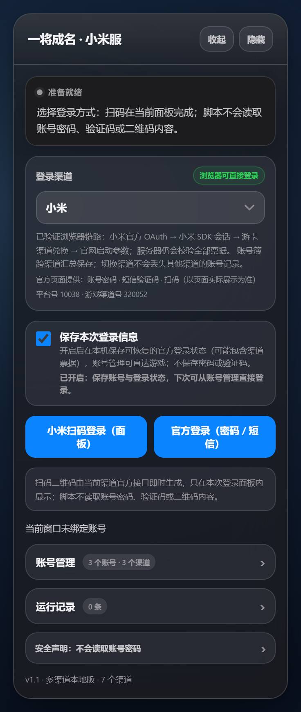
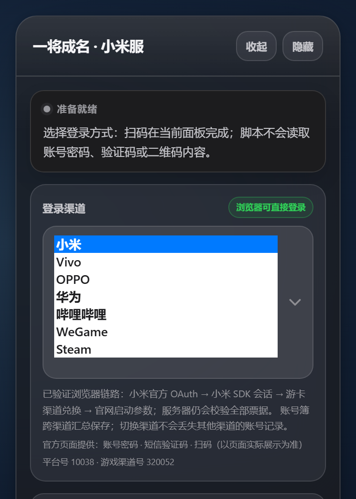
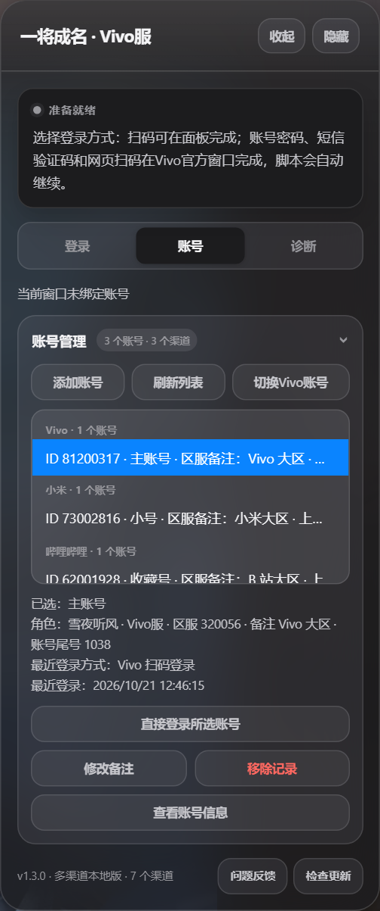
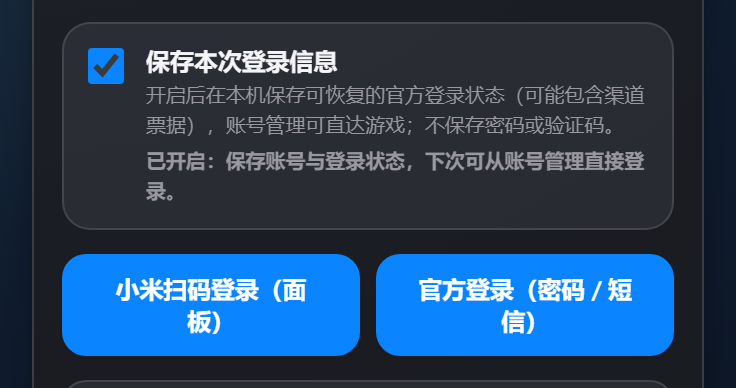

# 三国杀一将成名 · 多渠道网页登录器

在三国杀网页版登录页提供一个统一的多渠道登录面板，把当前浏览器会话接到渠道官方的扫码、网页授权和游卡兑换链路，并在本机提供账号管理与快速直登。

当前版本：`1.2.0`
支持渠道：小米、Vivo、OPPO、华为、哔哩哔哩、WeGame、Steam（共 7 个）  
运行方式：Tampermonkey 用户脚本（Chrome / Edge / QQ 浏览器极速模式）

> 本项目是本地辅助工具，不绕过官方登录、实名、支付或风控。最终能否登录仍由渠道服务器、游卡服务器及账号状态共同决定。  
> 截图中的账号名称、区服和记录均为演示数据。

## 第一作者与源码来源

- 第一作者：**@暗鹊**。
- 原始源码：[@暗鹊《统一登录器》](https://github.com/Clarrycy/jinnangmiaoji/blob/main/jinnangdai/payload/unified-login.user.js)。
- 本项目基于上述源码整理、维护与扩展。谨向 @暗鹊 致以诚挚感谢；本仓库并非 @暗鹊 官方发布。
- 维护者：softbad123。修改说明、第三方来源与许可证状态见 [THIRD_PARTY_NOTICES.md](THIRD_PARTY_NOTICES.md)。

## 1.2.0 更新

- 增加 GitHub Release 自动更新检查：每天最多检查一次，也可从面板或油猴菜单手动检查；发现新版本后打开固定的最新版安装地址。
- 增加本地反馈日志：自动记录启动、阶段状态和脚本自身异常，按 240 条、30 天、约 96 KiB 上限滚动保存；相同消息会合并计数。
- 日志写入前会隐藏 URL 查询参数、授权码、token、ticket、Cookie、会话字段和长随机标识；日志不上传，需用户主动复制或导出后提交问题。
- 运行记录增加“复制反馈日志”“导出反馈日志”和“问题反馈”入口；油猴菜单也可检查更新、复制日志、打开反馈页和清空本机日志。
- 面板改为“登录 / 账号 / 诊断”三页菜单，状态卡常驻；账号管理和诊断信息不再与登录按钮纵向堆叠，诊断页签会显示异常数量。
- 面板折叠态缩至 208px，只保留标题与“展开”按钮，减少对游戏页面的遮挡；拖动后的位置约束仍会自动校正。
- 游戏页读取到有效角色、区服或账号资料后，无论渠道服还是官服都会自动折叠一次；自动折叠后停止轮询，不会在用户手动展开后再次收起。

## 1.1.4 更新

- 增加 QQ 浏览器专项兼容：同站导航被浏览器提升到新标签、或浏览器清空 `window.name` 时，从标签级一次性交接记录恢复不透明路由名，不再直接丢失登录凭证。
- QQ 浏览器的无凭证入场守卫延长至 240 秒，与游戏交接上限一致，覆盖 Laya 资源加载和慢网络下延迟出现的 `EnterLoginScene` / `GotoLogout`；其他浏览器仍保持 60 秒。
- 修复登录回退目标错误：`/login/x/index` 或无有效交接的游戏页不再被送往经典 OL 的 `/login/index.html`，统一回到一将成名 `/login/10th_client/index.html`。
- 新增 QQ 浏览器交接回归测试，覆盖 `window.name` 丢失、标签标记匹配、跨标签拒绝和过期交接。

## 1.1.3 更新

- 修复 WeGame 在登录检测成功后进入加载页、加载完成又返回主登录页的问题：不再把 `PlatformID` 误当作游戏登录凭证，只有 `Token`、`Ticket` 或 `WeGameTicket` 已写入时才允许官方登录场景继续。
- 登录交接成功后保留 60 秒入场守卫，覆盖场景加载、游戏对象重绑定和慢网络下的延迟 `EnterLoginScene` / `GotoLogout` 调用；正常登录仍会立即继续。
- 面向慢网络的中间等待改为有界宽限：官方接口单次请求最多 60 秒，游戏交接与资料同步最多 240 秒。超时只用于防止永久卡住，不会人为拖慢正常流程。
- “游戏票据已提交”不再直接显示为“已登录”；只有读取到角色、区服或角色 ID 等真实游戏资料后，才把账号状态切换为 `connected`。

## 1.1.2 更新

- 修复 WeGame 账号被错误拼接为“区服待返回 · 未打开 · 待登录”的状态显示，改为明确的登录、区服和窗口状态。
- 进入游戏后从 `AccountInfo` 与 `UserData` 补充角色名、角色 ID、登录账号和区服。
- 账号资料同步只在游戏页、资料不完整时短时运行，不再全页面永久轮询。
- 在脚本元数据、登录面板、README 与许可证声明中补充第一作者 @暗鹊及固定源码链接。

## 界面预览

<table>
  <tr>
    <td align="center"><br><sub>主面板与登录入口</sub></td>
    <td align="center"><br><sub>7 个渠道选择</sub></td>
  </tr>
  <tr>
    <td align="center"><br><sub>账号管理与直接登录</sub></td>
    <td align="center"><br><sub>可选的本地登录状态保存</sub></td>
  </tr>
</table>

## 功能特性

- 统一面板：在三国杀网页版登录页切换渠道，不需要分别安装多个渠道脚本。
- 官方登录链路：扫码在当前面板完成；账号密码、短信验证码、Steam Guard 等敏感操作在渠道官方页面完成。
- 账号管理：保存账号展示信息后，可在账号管理中选择账号并直接登录；跨渠道账号会自动切换渠道后继续。
- 菜单式面板：登录、账号和诊断分页展示，避免功能增加后产生超长纵向滚动；仅当前页内容参与布局。
- 保存本次登录信息：默认开启。开启后只在本机保存可恢复的官方登录状态；关闭后不留下本次登录记录。
- 自动收尾：检测到官方账号登录完成后关闭本次登录弹窗；渠道服或官服读取到有效游戏账号资料后自动将面板收起为紧凑标题栏。
- 独立流程：WeGame 的 QQ 与微信使用独立流程令牌、会话键和恢复记录，避免相互取消。
- 自动更新：每天最多检查一次 GitHub Release；可在面板或油猴菜单手动检查。更新仍由 Tampermonkey 的脚本安装/更新链路完成。
- 本地优先：账号、会话和反馈日志只写入 Tampermonkey 本地存储，不上传到额外服务器。
- 诊断信息：只记录版本、渠道、阶段和 HTTP 状态等排错信息，不输出 Cookie、token、票据、密码或验证码。

## 支持渠道

| 渠道 | 平台号 | 游戏渠道号 | 登录方式 | 说明 |
| --- | ---: | ---: | --- | --- |
| 小米 | 10038 | 320052 | 面板扫码；官方网页登录 | 官方 OAuth 与网页版游戏交接 |
| Vivo | 10031 | 320056 | 面板扫码；官方网页登录 | 官方 passport 与 joint 桥接 |
| OPPO | 10030 | 320123 | HeyTap 官方扫码 / 手机号等网页方式 | 官方 code 一次性回传 |
| 华为 | 332 | 320459 | 面板扫码 | 二维码、账号授权与游卡兑换 |
| 哔哩哔哩 | 50003 | 120133 | 面板扫码 | access_key 与游戏回调交接 |
| WeGame | 326 | 320023 | QQ 扫码；微信扫码 | QQ / 微信使用独立流程和会话记录 |
| Steam | 50000 | 320061 | Steam 官方 OAuth 网页 | 扫码、账号密码和 Steam Guard 以官方页面为准 |

4399、飞火、顺网、2144、紫霞、QQ 大厅、7K7K、百度、360 等门户渠道不在本脚本的下拉框中显示；请直接在对应官网登录和进入游戏。

## 安装方法

### 方式一：从 Release 安装（推荐）

1. 在 Chrome、Edge 或 QQ 浏览器极速模式中安装 [Tampermonkey](https://www.tampermonkey.net/)。建议使用 `5.5.1` 或更新版本；旧版 `4.18.1` 在 QQ 浏览器使用的 Chromium 138 中可能无法注入脚本。
2. 打开本项目的 [最新 Release](https://github.com/softbad123/sanguosha-channel-login/releases/latest)。
3. 下载固定更新地址中的 [`sanguosha-channel-login.user.js`](https://github.com/softbad123/sanguosha-channel-login/releases/latest/download/sanguosha-channel-login.user.js)，在 Tampermonkey 中导入并启用。Release 中可能同时提供带版本号的副本，内容相同。
4. 停用或删除旧的“小米服登录器”“统一登录器”以及旧版“三国杀多渠道登录”脚本，避免同页重复注入。
5. 打开 <https://web.sanguosha.com/login/10th_client/index.html>。
6. 页面右侧出现登录面板后，确认页脚显示 `v1.2.0 · 多渠道本地版 · 7 个渠道`。

### 方式二：从源码安装

1. 下载仓库中的 `三国杀多渠道登录.user.js`。
2. 打开 Tampermonkey 管理面板，进入“实用工具 → 从文件导入”，选择该文件。
3. 保存并确认脚本处于启用状态，然后刷新三国杀登录页。

也可以新建一个用户脚本，将 `三国杀多渠道登录.user.js` 的完整内容粘贴进去后保存。不要同时启用多个会注入登录面板的版本。

## 使用说明

### 选择渠道并登录

1. 在面板的“登录渠道”下拉框中选择渠道。
2. 点击对应的扫码或官方网页登录按钮。
3. 面板扫码时，用手机完成扫码和确认；官方网页登录时，在弹出的官方页面完成账号密码、短信或第三方登录。
4. 官方账号识别成功后会关闭本次登录弹窗；读取到有效角色、区服或账号资料后，渠道服与官服都会自动把面板收起为紧凑标题栏。
5. 需要继续操作时，点击标题栏的“展开”。

### 账号管理

- 选择已有账号后点击“直接登录所选账号”，脚本会优先复用本机保存且仍有效的登录状态。
- 保存的 SGS 票据失效时，脚本会用本机保存的上游渠道凭据重新兑换一次游戏票据；失败不会删除账号记录。
- 选择其他渠道的账号时，按钮会显示“切换到对应渠道并直接登录”，切换后自动继续，不需要再次点选登录方式。
- 已打开的账号窗口会被优先聚焦；只有当前标签页正在游戏且需要添加另一个账号时，才会打开独立账号窗口。
- 账号管理只展示昵称、角色名、区服、账号标识、最近登录方式和备注等必要信息。

### 保存本次登录信息

- 开关默认开启。开启时，成功登录后会保存账号展示信息和可用于下次恢复登录的渠道会话记录；其中可能包含渠道 token 或票据。
- 关闭时，本次登录仍可完成游戏交接，但不会新增或更新持久账号记录，也不会写入可恢复会话；因此下次无法从账号管理直接恢复这次登录。
- 移除账号记录时，会同时清理该账号名下保存的恢复会话。
- 保存内容位于 Tampermonkey 的本地存储中。分享脚本源码不会带走这些记录；分享浏览器配置、Tampermonkey 数据目录或整机备份则可能带走。

### WeGame 的 QQ 与微信

QQ 和微信是两条独立登录流程，分别使用独立的流程令牌、会话键和恢复记录。先登录 QQ 再登录微信，或反向切换，不会让旧流程的取消事件终止新流程。

### Steam

Steam 登录使用 `store.steampowered.com` 官方 OAuth 页面。扫码、账号密码和 Steam Guard 都由 Steam 官方页面处理；插件只接收一次性的官方回调结果。若页面无法加载，请先确认浏览器可正常打开 Steam 商店并检查网络或代理。

## 安全与隐私

- 不读取账号密码、短信验证码、验证码输入框或剪贴板。
- 不保存账号密码或验证码。
- 渠道授权信息只在本机临时状态或用户开启的恢复记录中保存，不上传到额外服务器。
- 游戏启动票据只在当前标签页短暂保留并一次性消费。
- 反馈日志只保存在本机，不会静默上传；复制或导出前会隐藏 URL 查询参数及常见的 token、ticket、授权码、Cookie 和会话字段。
- 脚本的 `@connect` 只列出登录流程所需的官方域名；如需审计，请从 `三国杀多渠道登录.user.js` 头部开始检查。
- 不要把 `_chrome-profile*`、`_edge-profile*`、`_tm-extension`、浏览器配置目录、日志、抓包 HTML、二维码截图或 Tampermonkey 数据目录上传到公开仓库。

## 常见问题

**面板没有出现**  
确认 Tampermonkey 已启用、脚本匹配 `https://web.sanguosha.com/*`，并停用其他旧登录脚本后刷新页面。QQ 浏览器请使用极速模式，并升级到 Tampermonkey `5.5.1+`；`4.18.1` 可能显示扩展已启用但无法向 Chromium 138 页面注入脚本。

**QQ 浏览器菜单显示“没有运行中的脚本”**

“已启用”只表示 Tampermonkey 扩展本身已启用；“没有运行中的脚本”表示当前标签页没有匹配到正在运行的用户脚本。请确认页面处于 QQ 浏览器“极速模式”而非兼容/IE 模式，Tampermonkey 的站点访问权限允许 `web.sanguosha.com`，脚本已在管理面板启用；导入后对目标页执行硬刷新（`Ctrl+Shift+R`）或重新打开标签页。若登录面板已经出现，说明注入正常，后续跳回登录页应按下一节的交接问题排查。

**扫码成功但游戏没有继续**  
先查看面板状态和“运行记录”中的阶段与 HTTP 状态；不要连续点击多个渠道按钮，等待当前流程结束或先取消。

**账号管理直登失败**  
本机恢复会话可能已失效。账号记录会保留，重新完成一次该渠道的官方授权后即可再次直登。

**Steam 页面打不开**  
确认 `store.steampowered.com` 可访问，并检查代理、DNS 和浏览器拦截规则。

**华为 / 哔哩哔哩没有账号密码入口**  
这两个渠道当前只保留经过验证的扫码或官方登录链路，不展示无法完成游戏交接的灰色按钮。

**WeGame 显示“区服未记录 / 区服未同步”**

这不是“登录失败”或“区服接口仍在等待”。账号刚授权时尚未进入游戏，区服会显示为未记录；游戏认证成功后，插件会从 `AccountInfo` / `UserData` 自动补充，最多短时轮询 240 秒。若进入角色大厅后仍未同步，请导出诊断。旧版本显示的“区服待返回 · 未打开 · 待登录”属于三个独立状态被错误拼接，`1.1.1` 已移除这组文案。

**登录后进入加载页，又返回主登录页**

`1.1.3` 已修复 WeGame 的 `PlatformID` 凭证误判；`1.1.4` 又修复了 QQ 浏览器丢失 `window.name` 后交接无法恢复，以及回退到经典 OL 登录页的问题。若仍复现，请先确认版本为 `1.2.0`、Tampermonkey 为 `5.5.1+`、没有同时启用旧版登录脚本，再从“运行记录”复制或导出反馈日志；日志中应关注 `AccountInfo.Self` 是否存在 `Token`、`Ticket` 或 `WeGameTicket`，以及是否出现 `GotoLogout`。QQ 浏览器慢网下请给官方请求和游戏加载最多 4 分钟，不要连续重复点击登录。

**慢网络下如何理解超时**

脚本没有加入固定延时。官方接口请求最多等待 60 秒，票据交给游戏后的入场与资料同步最多等待 240 秒；QQ 浏览器的无凭证入场守卫也使用完整的 240 秒上限。网络恢复后流程会继续。若超过上限仍失败，通常是渠道票据失效、游戏服务器不可达或页面已关闭，请重新发起官方授权而不是反复点击旧流程。

## 开发与验证

- `_direct_engine.js` 是独立登录引擎；主脚本中的内嵌引擎必须与其逐字一致。
- `tests/_test_embedded_engine_sync.js` 同时校验内嵌一致性以及元数据、宿主、引擎三处版本号。
- `tests/_test_login_options.js` 校验 7 个可见桥接渠道，并确认荣耀渠道不再注册。
- `tests/_test_registry_security.js` 校验渠道域名与 `@connect` 配置一致。
- `tests/_test_wegame_profile.js` 校验 WeGame 状态文案、区服读取和角色资料回填。
- `tests/_test_credits.js` 校验第一作者、固定源码链接和 Apache-2.0 许可证声明。
- `tests/_test_qq_handoff.js` 校验 QQ 浏览器标签被提升后的交接恢复、标签隔离与守卫时长。
- `tests/_test_updates_feedback.js` 校验版本比较、固定更新地址、日志脱敏/去重/上限、官服登录判定与紧凑折叠结构。
- 账号恢复、WeGame 竞态、Vivo / OPPO / Steam / B 站交接等均保留 Node 回归测试。

运行纯 Node 回归测试：

```bash
npm test
```

运行环境要求 Node.js 18 或更高版本。浏览器集成测试不在默认 `npm test` 中，需要额外的 Chrome DevTools Protocol 环境。

## 免责声明

本项目为非官方辅助工具，与游卡及任何渠道官方无隶属关系。请遵守对应平台的用户协议和当地法律法规，仅用于管理本人账号。渠道接口或页面结构变化时，登录可能暂时失效；请以官方页面和服务器返回结果为准。

## 许可证

本项目维护者原创的修改与新增部分使用 [MIT License](LICENSE) 开源；源自 @暗鹊《统一登录器》的部分继续受 [Apache License 2.0](LICENSES/Apache-2.0.txt) 约束。再分发时请保留作者署名、固定源码链接、修改声明与 Apache-2.0 许可证副本。小米服相关参考实现的授权状态仍需单独核实，详见 [THIRD_PARTY_NOTICES.md](THIRD_PARTY_NOTICES.md)。
